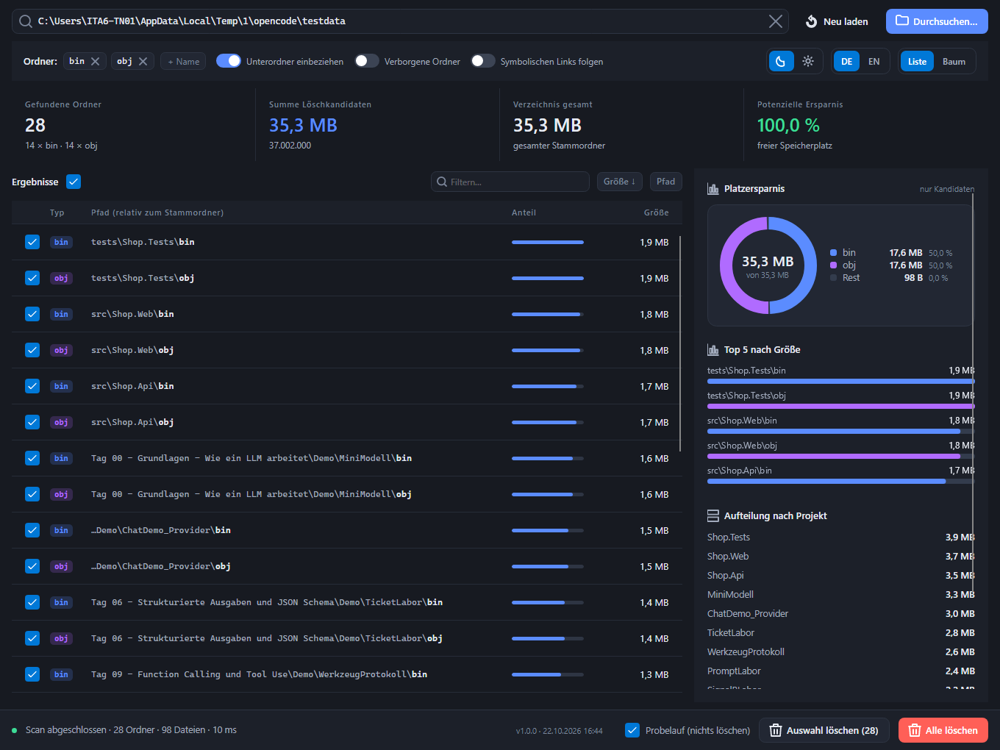

# BinObj Cleaner

Avalonia-Anwendung, die in einem Stammverzeichnis rekursiv alle `bin`- und `obj`-Ordner
findet, deren Größe ausweist und sie auf Wunsch löscht. Die Oberfläche zeigt, wie viel
Platz durch die Löschung freigeräumt würde.



## Funktionsumfang

| Bereich | Beschreibung |
|---|---|
| **Suche** | Rekursiv nach `bin`/`obj` (frei konfigurierbar) suchen. Optionen: Unterordner, versteckte Ordner, symbolische Links. |
| **Auswertung** | Größe je Ordner, Anzahl Dateien, Summe der Kandidaten, Gesamtgröße des Stammverzeichnisses und die daraus erreichbare Platzersparnis in Prozent. |
| **Diagramme** | Donut-Diagramm (bin/obj/Rest), Top-5-Balkendiagramm und Aufteilung nach Projekt – gezeichnet mit eigenen SkiaSharp-Controls. |
| **Löschen** | Auswahl oder alle Ordner löschen – wahlweise in den Windows-Papierkorb oder endgültig. Sicherheitsabfrage mit Probelauf. |
| **Darstellung** | Umschaltbares Dark-/Light-Theme, deutsch/englisch zur Laufzeit umschaltbar, Listen- oder Baumansicht. |

## Projektstruktur

```
BinObjCleaner/
├── BinObjCleaner.slnx
├── src/BinObjCleaner/
│   ├── App.axaml(.cs)              Anwendung, Theme-Ressourcen (Dark/Light)
│   ├── Program.cs                  Avalonia-Bootstrap
│   ├── Controls/                   DonutChart, BarChart (SkiaSharp), AppIcon, PathText
│   ├── Models/                     Domänenmodelle (ArtifactFolder, FolderTreeNode, ...)
│   ├── Services/                   Scanner, Größenberechnung, Löschung, Settings, Lokalisierung
│   ├── ViewModels/                 MainWindowViewModel, Converter, MVVM-Basis
│   ├── Views/                      MainWindow, DeleteConfirmDialog, UI-Dienste
│   ├── Infrastructure/             SnapshotCapture (Screenshot-Hilfe für Doku/CI)
│   ├── Assets/                     appicon.png (Fenstersymbol)
│   └── Strings/                    strings.json (Quelle) + Strings.de/en.resx
├── tests/BinObjCleaner.Tests/      xUnit-Tests der Kernlogik
└── tools/GenerateResx.ps1          Erzeugt die .resx-Dateien aus strings.json
```

## Bauen und Starten

```bash
dotnet build BinObjCleaner.slnx
dotnet run --project src/BinObjCleaner
dotnet test
```

Voraussetzung: .NET 10 SDK.

### Wichtig: „nichts hat sich geändert" nach einem Build

Läuft die App beim Build, kann MSBuild die EXE nicht ersetzen:

```
warning MSB3026: "…\BinObjCleaner.exe" konnte nicht in "bin\Debug\net10.0\BinObjCleaner.exe"
kopiert werden. Die Datei wird durch "BinObjCleaner" gesperrt.
```

Visual Studio startet dann die **alte** Datei – der Build war zwar erfolgreich, die Änderungen
sind aber nicht angekommen. Drei Wege, das zu vermeiden:

| Weg | Verhalten |
|---|---|
| `start.cmd` (im Projektordner) | beendet laufende Instanzen, baut neu und startet die frische EXE |
| App vor dem Start schließen | Alt+F4, dann F5 in Visual Studio |
| Build-Info prüfen | Der Fenstertitel und die Fußleiste zeigen `v1.0.0 · <Build-Zeit>` – weicht die Zeit vom letzten Build ab, läuft eine alte Datei |

Zusätzlich gibt es eine veröffentlichte, immer frische Version:
`artifacts\publish\BinObjCleaner.exe` (per Doppelklick startbar).

## Architektur

* **MVVM** – `MainWindowViewModel` enthält sämtliche Logik der Oberfläche; die Views enthalten
  keine C#-Logik (Ausnahme: das Entfernen eines Ordner-Chips läuft über einen Click-Handler,
  weil der Eintrag eine reine Zeichenkette ist).
* **Testbare Kernlogik** – Scanner, Größenberechnung, Löschung, Settings und Lokalisierung sind
  UI-frei und werden von xUnit-Tests abgedeckt. Steuerelement-Tests laufen über
  `Avalonia.Headless` (eigene Fixture `AvaloniaFixture`).
* **MVVM ohne Fremdpakete** – `ObservableObject` und `RelayCommand` sind im Projekt enthalten,
  damit keine zusätzliche Abhängigkeit nötig ist.
* **Eigene Symbole** – `AppIcon` (eine Ableitung von `Path`) stellt die Strichzeichnungen des
  Mockups als 24×24-Geometrien bereit (Ordner, Papierkorb, Lupe, Diagramm, Warnung, Mond/Sonne).
  Die Farbe kommt aus dem umgebenden Control, in Buttons über die Vordergrundfarbe.
  *Hinweis:* `AppIconKind.Search` ist der Standardwert des Enums – beim Setzen aus dem XAML
  ändert sich der Wert also nicht und es feuert keine Property-Änderung. Die Geometrie wird
  deshalb bereits im Konstruktor gesetzt (Regressionstest vorhanden).
* **Pfadspalte** – eigens Control `PathText`: Verzeichnisanteil (gedimmt) + `\` + Ordnername (fett).
  Gekürzt wird zur Render-Zeit anhand der tatsächlich verfügbaren Breite und
  **an Verzeichnisgrenzen von vorne** – so bleibt der Projektordner sichtbar statt
  mitten im Ordnernamen abgeschnitten zu werden. Der Ordnername ist immer sichtbar,
  der vollständige Pfad steht im Tooltip. Die Kürzungslogik liegt testbar in
  `PathShortener`.
* **Segment-Schalter als Auswahl** – Design, Sprache und Ansicht sind an `IsDarkTheme`,
  `IsGerman` bzw. `IsTreeView` gebunden; die Setter wenden die Einstellung sofort an und
  melden abgelehnte Schreibvorgänge, damit die Anzeige synchron bleibt.
* **Compiled Bindings** – `AvaloniaUseCompiledBindingsByDefault` ist aktiv; fehlerhafte
  Bindungen erscheinen daher bereits beim Build als Fehler.
* **Lokalisierung** – Texte liegen als `.resx` (de/en) vor. `strings.json` ist die Quelle;
  `tools/GenerateResx.ps1` erzeugt daraus die Ressourcen-Dateien:

  ```powershell
  powershell -ExecutionPolicy Bypass -File tools/GenerateResx.ps1
  ```

### Wichtig: Avalonia 12 rendert auf einem eigenen Thread

Avalonia 12 führt `ICustomDrawOperation.Render` auf dem **Render-Thread des Compositors** aus –
nicht auf dem UI-Thread. Jeder Zugriff auf Avalonia-Properties (`GetValue`, `TryFindResource`,
`Bounds`) im Render-Code löst deshalb

```
System.InvalidOperationException: The calling thread cannot access this object because a different thread owns it.
```

aus. Die beiden Diagramm-Controls folgen dem Muster *Render-Snapshot*:

1. `OnPropertyChanged` und der `CollectionChanged`-Handler kopieren alle benötigten Werte im
   UI-Thread in einfache Felder (`UpdateRenderSnapshot`).
2. `Render(ImmediateDrawingContext)` liest ausschließlich diese Felder – keine Avalonia-Properties.
3. `ICustomDrawOperation.Bounds` wird ebenfalls zwischengespeichert, weil der Compositor die
   Bounds auf dem Render-Thread abfragt.

Die Kultur für die Größenformatierung wird ebenfalls im UI-Thread übernommen, damit die
Anzeige unabhängig von der Thread-Kultur bleibt.

## Löschen und Sicherheit

1. Vor dem Löschen erscheint ein Bestätigungsdialog mit Ordnerzahl, Dateizahl, zu löschender
   Größe und Anteil am Stammverzeichnis.
2. Standardmäßig ist der **Probelauf** aktiv – es wird nur angezeigt, was gelöscht würde.
3. Der Papierkorb-Schalter ist im Dialog und in der Optionsleiste verfügbar. Auf Systemen ohne
   Papierkorb wird automatisch endgültig gelöscht (mit entsprechendem Hinweis).

## Farbpalette und Eingabefelder

* **Ein einziger Blauton** – `AppAccentBrush` wird für alle Controls verwendet: Buttons,
  Fokusrahmen, ausgewählte Segmente, Typenschild `bin`, Fortschrittsbalken und das
  Diagrammsegment `bin`. Der einzige weitere Farbton ist `AppSecondBrush` (violett) für die
  Kategorie `obj`; dazu kommen neutrale Grautöne sowie Rot/Grün für Statusmeldungen.
  Alle Farben liegen als Theme-Dictionaries in `App.axaml` (Dark/Light).
* **Eingabefelder** – der Rahmen kommt aus dem Style (`Border.input`) und **nicht** aus einer
  inline gesetzten Eigenschaft, sonst könnte der Fokus-Zustand (`Border.field.focused`)
  ihn nicht einfärben. Der Fokus-Indikator des Fluent-Themes ist abgeschaltet
  (`FocusAdorner = null`), damit kein Ring über die Feldgrenzen hinausragt.

## Screenshots erzeugen

Die Anwendung kann ihr eigenes Fenster als PNG rendern – unabhängig von der Desktop-Umgebung:

```powershell
$env:BINOBJCLEANER_SNAPSHOT = "C:\pfad\zum\bild.png"
dotnet run --project src/BinObjCleaner
```

Zusätzlich entsteht `<bild>-dialog.png` mit dem Bestätigungsdialog.

## Bekannte Einschränkungen

* Die Größenberechnung folgt den tatsächlichen Dateigrößen (logische Clustersize auf NTFS wird
  nicht berücksichtigt).
* Verzeichnisse ohne Zugriffsrecht werden übersprungen – die angezeigte Gesamtsumme kann
  daher kleiner als die reale Belegung sein.
* Symbolische Links werden standardmäßig nicht verfolgt, damit keine Schleifen entstehen und
  keine fremden Daten gelöscht werden.
